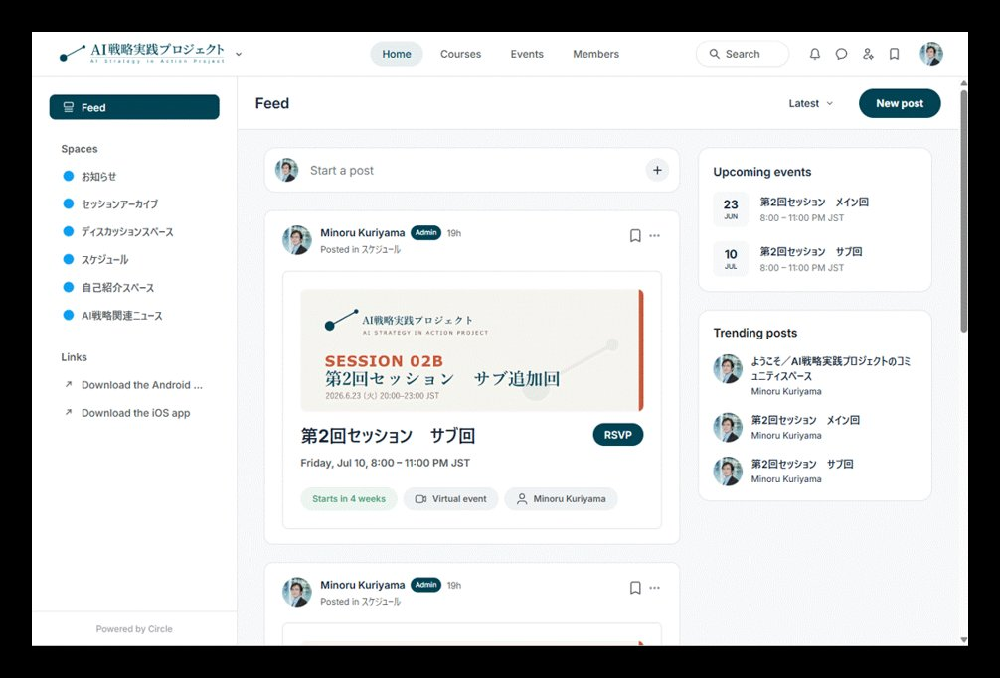
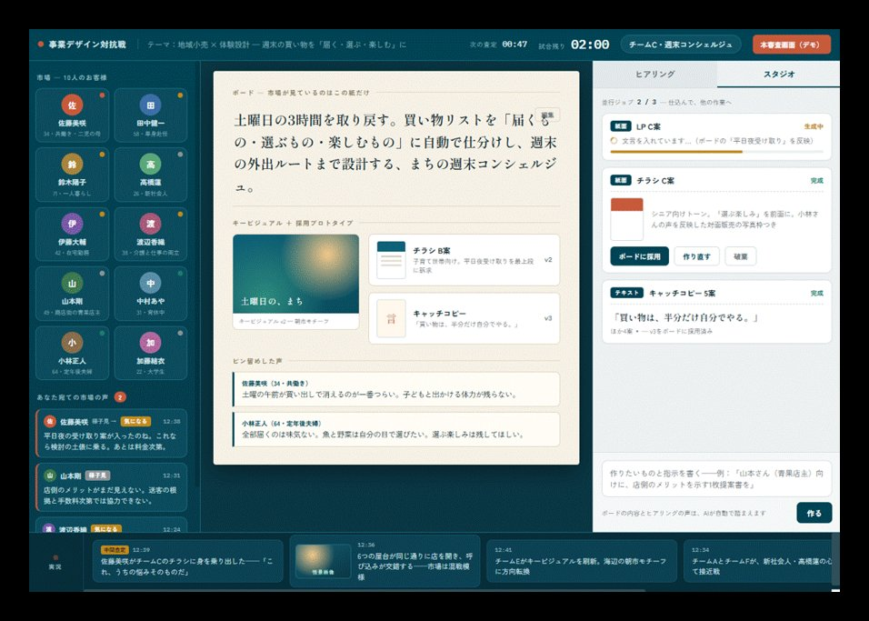
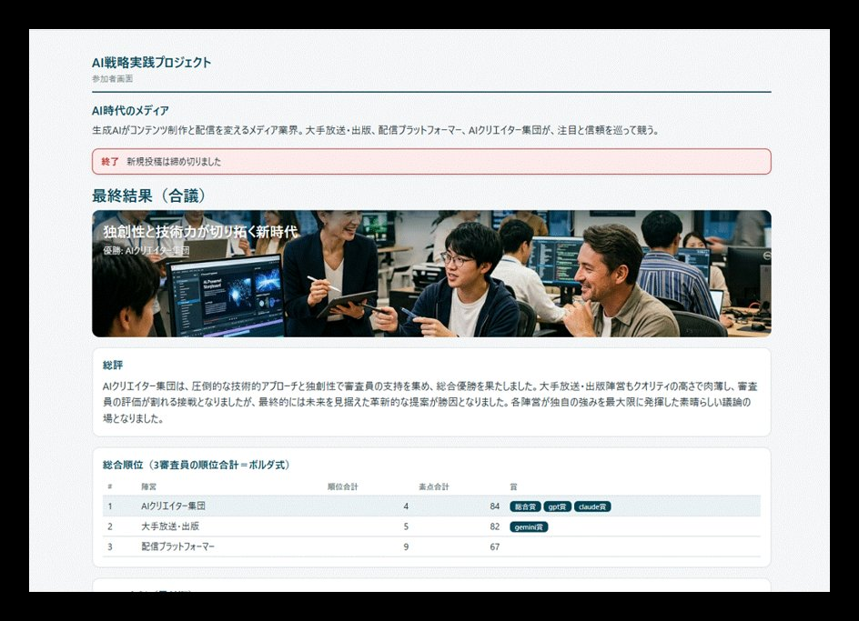

# セッションの進め方と開催予定

各回は独立したテーマとし、前回までの知識は前提としない形式で進めます。途中からの
ご参加も歓迎します。各回は **A日程・B日程の2日程で、同じ内容** を開催します。
進め方・手元に残るもの・今後の開催予定をまとめています。

## 各セッションの構成例（約2〜2.5時間 ＋ 交流タイム）

各回は「**戦略的な問い・文脈から出発し、手を動かして仕組みを作り、戦略インパクトを
考える**」という一貫した流れで進めます。テーマに応じて構成は柔軟に調整しますが、概ね
以下の要素で構成します。

**1. 戦略的な問い・文脈の提示と、参加者自身の言語化**
:   その回のテーマが「なぜ戦略的に重要なのか」を考える問いからスタート。参加者自身の
    事業・業界の文脈で課題を言語化し、AIにも同じ問いを考えさせて比較するなど、
    「Why before How」を実践します。

**2. AIで動かす、作る ——AIとの対話から、動く仕組みへ**
:   AIとの対話（チャット）から始めて、AIにコードやコンテンツを作らせ、段階的にシステムと
    して動く仕組みへと発展させます。プログラミング経験は前提としません。各自の事業・業界に
    応じた設計をAIに作らせるなど、動的に仕組みを作っていきます。

**3. 戦略視座に立ち戻る**
:   作ったものをもとに、自社の文脈にどう適用するか、どのような戦略インパクトがあり得るかを
    考えます。ツールの便利使いで終わらせず、AIによる産業構造や組織構造の転換にまで波及する
    戦略文脈にどう位置付けられるか、意識的に視野を広げます。

**4. まとめと次回予告**
:   持ち帰り用のファイル一式の確認と、次回テーマの予告。

**終了後 ─ 質問回答・交流（最大60分程度）**
:   本編終了後、質問にお答えしたり、参加者同士で感想や最新トピックを交わしたりする自由な
    時間です。

## セッション後にお手元に残るもの（ある回の例）

- 当日使用した映写資料
- 各自で実行・改変可能なサンプルコード（Python／Google Colaboratoryを主に使用）
- AIとの対話で使用したサンプルプロンプト・関連データファイル一式
- 事前に作り込んだ発展版のコード・アプリケーションのデモと解説
- セッション後に各自で取り組んでバリエーションを広げるための自習ガイド
- Zoom録画（当日参加できなかった方を含む有償メンバー全員に共有）

ビジネスで多忙な方が、録画・資料での参加でもAI操作の体験を各自のタイミングで進められる
よう設計しています。

## これからの開催

各回は **A日程・B日程の2日程で、同じ内容** です。どちらか都合のよい日程にご参加ください。
**いずれも20:00開始・オンライン（Zoom）**、約2〜2.5時間です。

{{ upcoming_rounds(2) }}

{{ register_button() }}

## 開催予定（全回）

継続して参加される方は、カレンダー等にお控えください。開催日を過ぎた日程には「開催済み」と出ます。

{{ schedule_list() }}

これまでの各回のテーマ・扱った領域は **[開催履歴](history.md)**、参加方法は
**[参加する](../join/index.md)** をご覧ください。

## 参加者コミュニティ（Circle）

有償メンバーには、参加者向けコミュニティ（Circle）へのご招待をお送りします。各回のご案内、過去回の
アーカイブ、AI戦略関連ニュースの解説、参加者同士のディスカッションが続きます。AI時代の戦略の
引き出しを、継続して積み重ねる場です。

お知らせ・セッションアーカイブ・AI戦略関連ニュース・ディスカッションのスペースを用意しています。

## セッションで使うアプリ（例）

各回では、その場で手を動かすための実践アプリを用意します。下記は過去回で実際に使ったアプリの
画面例です（クリックで拡大）。

<figure markdown="span">

<figcaption>事業デザイン対抗戦 ── 市場の声を聞き、AIとキービジュアル・コピー・プロトタイプを作り込む。</figcaption>
</figure>

<figure markdown="span">

<figcaption>AI戦略対抗戦 ── 複数のAI（Gemini／Claude／GPT）が多視点で評価・合議し、戦略案を採点する。</figcaption>
</figure>

## 今後の展開（検討中）

参加者コミュニティ（Circle）・セッションのアーカイブ・実践アプリを使える環境は、すでに運用しています。
これに加えて、以下を検討しています。

- 対面セッション・交流会の不定期開催（費用別途）
- 取り扱いテーマの募集

法人向けの個別開催・テーマのカスタマイズは、**[法人の方へ](../join/corporate.md)** で承っています。

{{ footer_cta("[開催履歴](history.md)", "[背景と狙い](../about/index.md)", "[設計思想](../about/philosophy.md)") }}
