# セッションの進め方と開催予定

各回は独立したテーマとし、前回までの知識は前提としない形式で進めます。いつからでも
ご参加いただけます。各回は **A日程・B日程の2日程で、同じ内容** を開催します。
進め方・手元に残るもの・今後の開催予定をまとめています。

## 1回の流れ

テーマに応じて構成は調整しますが、おおむね次の流れで進めます。

{{ session_flow() }}

## セッション後にお手元に残るもの

- 当日のスライド
- 使ったファイルと指示文（Google Colab で動かせるものを含む）
- A・B日程それぞれの録画と音声、文字起こし、ダイジェスト記事
- 事前に作り込んだ発展版のアプリのデモと解説
- 各自でバリエーションを広げるための自習ガイド

有償メンバーは、入会した日から、これまでのすべての回の記録を見られます（メンバースペース）。
各回を場面ごとに見返せるビューア、「必見だけ20分」の見方、これまでの記録を言葉で探して聞ける機能、
業界×業務で並べた課題の棚（AIで解決に挑戦できるテーマ集。{{ config.extra.lp.issues_count }}）もあります。

<figure markdown="span">
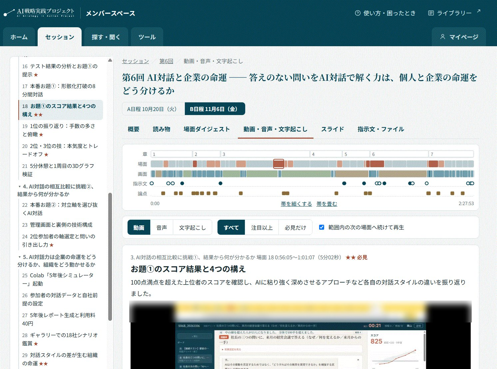{ loading=lazy }
<figcaption>メンバースペース：各回を場面ごとに見返す</figcaption>
</figure>
<figure markdown="span">
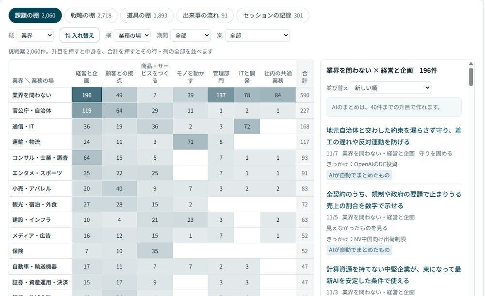{ loading=lazy }
<figcaption>課題の棚：AIで解決に挑戦できるテーマ集（業界×業務）</figcaption>
</figure>

## これからの開催

各回は **A日程・B日程の2日程で、同じ内容** です。どちらか都合のよい日程にご参加ください。
**いずれも20:00〜22:30ごろ・オンライン（Zoom）** です。各回を開くのは、その月のこの2日程だけです。

{{ upcoming_rounds(2) }}

{{ register_button() }}

## 開催予定（全回）

継続して参加される方は、カレンダー等にお控えください。開催日を過ぎた日程には「開催済み」と出ます。

{{ schedule_list() }}

これまでの各回のテーマ・扱った領域は **[開催履歴](history.md)**、参加方法は
**[参加する](../join/index.md)** をご覧ください。

## 参加者コミュニティ（Circle）

有償メンバーには、参加者向けコミュニティ（Circle）へのご招待をお送りします。各回のご案内、過去回の
アーカイブ、参加者同士のディスカッションに加えて、毎朝、AIがニュースを集め、これまでの回と結びつけて
読み解いた投稿が届きます。AI時代の戦略の引き出しを、継続して積み重ねる場です。

<figure markdown="span">
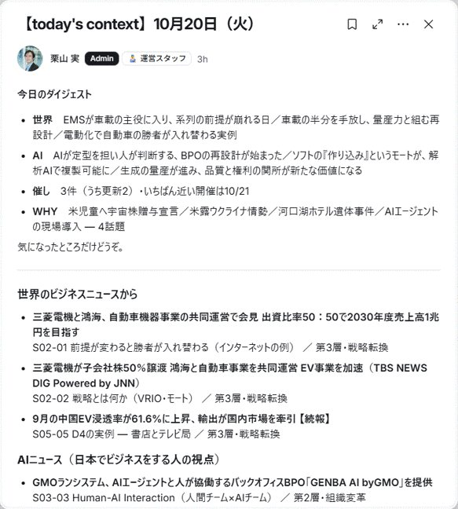{ loading=lazy }
<figcaption>{{ config.extra.lp.captions.news }}</figcaption>
</figure>

## セッションで使うアプリ（例）

各回では、その場で手を動かすための実践アプリを用意します。下記は過去回で実際に使ったアプリの
画面例です（クリックで拡大）。

<figure markdown="span">
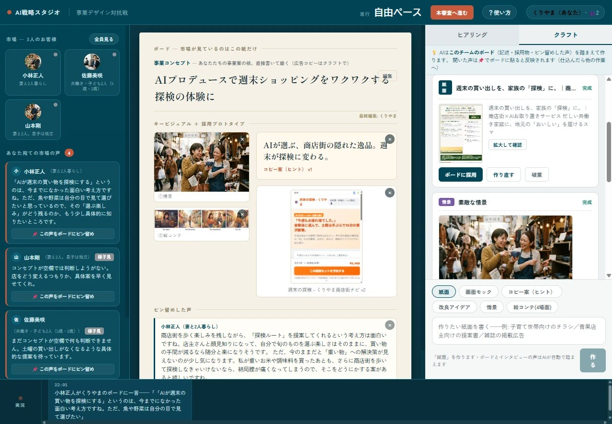{ loading=lazy }
<figcaption>AI戦略スタジオ：チームで事業の案をつくる</figcaption>
</figure>
<figure markdown="span">
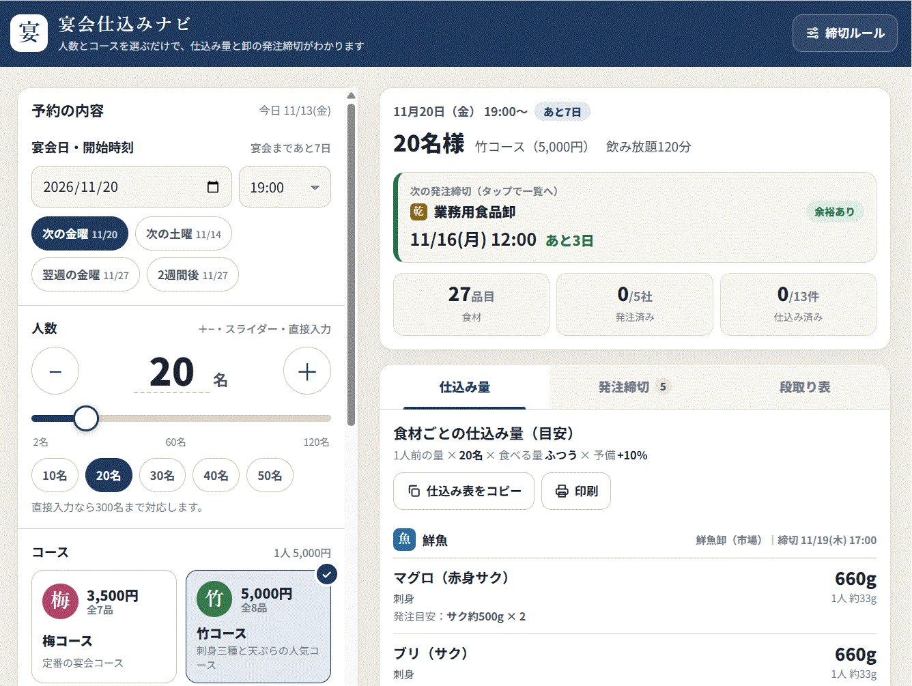{ loading=lazy }
<figcaption>AIで作った業務アプリの例</figcaption>
</figure>
<figure markdown="span">
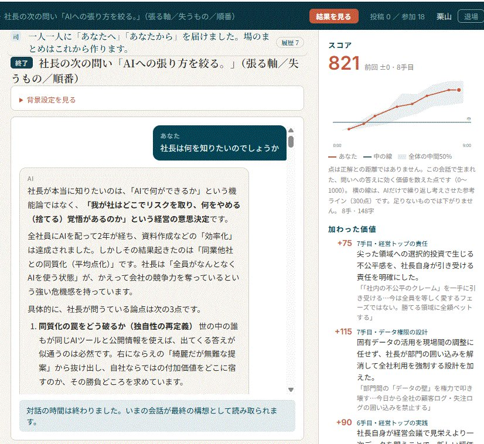{ loading=lazy }
<figcaption>10月の回の対話アリーナ：同じ問いでAIと対話し、深まりを1往復ごとに点数で見る</figcaption>
</figure>
<figure markdown="span">
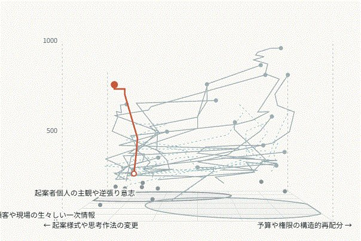{ loading=lazy }
<figcaption>10月の回：全員の対話の軌跡</figcaption>
</figure>
<figure markdown="span">
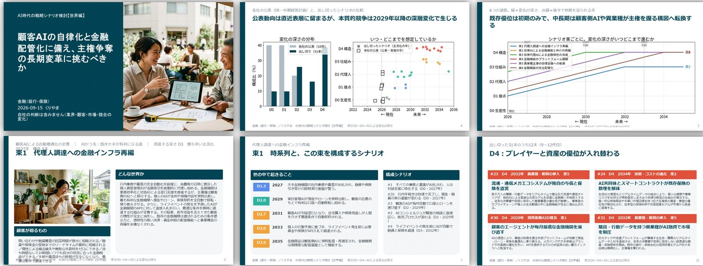{ loading=lazy }
<figcaption>9月の回：AIと書いた未来シナリオのレポート</figcaption>
</figure>
<figure markdown="span">
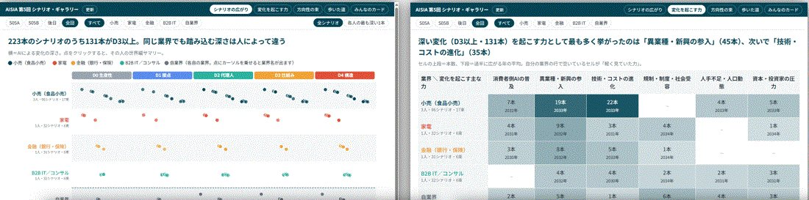{ loading=lazy }
<figcaption>9月の回のシナリオ・ギャラリー：参加者がAIと作った223本のシナリオを、全員で見比べる</figcaption>
</figure>
<figure markdown="span">
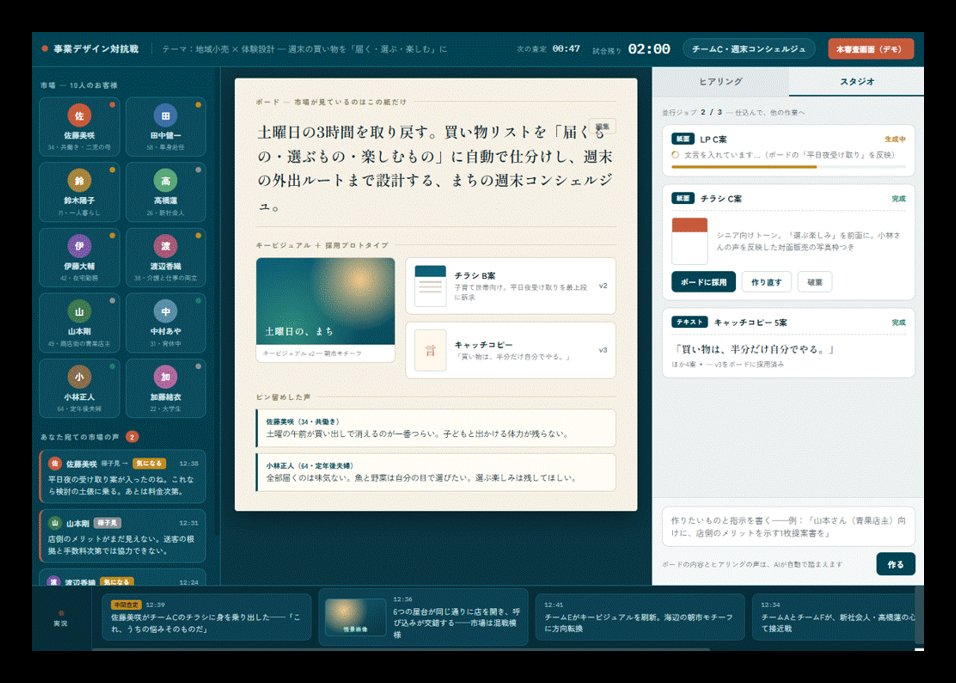{ loading=lazy }
<figcaption>AI事業デザインゲーム：市場の声を聞き、AIとキービジュアル・コピー・プロトタイプを作り込む</figcaption>
</figure>
<figure markdown="span">
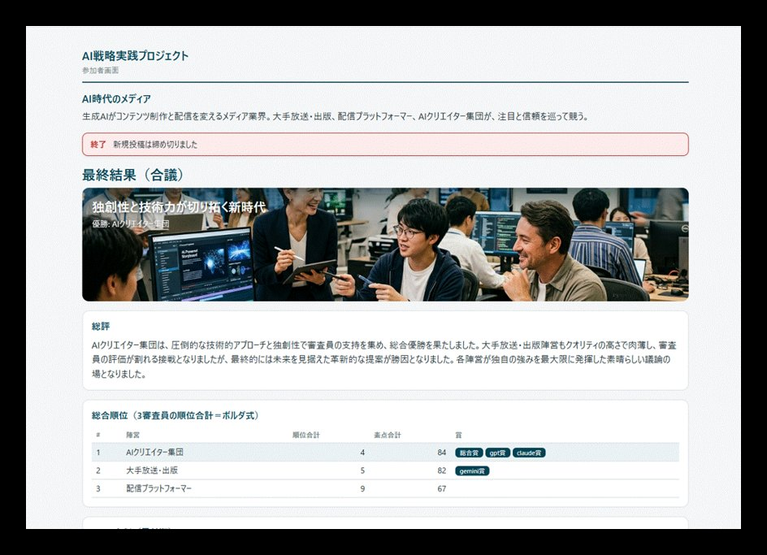{ loading=lazy }
<figcaption>ゲーム形式の戦略づくり：複数のAIが多視点で評価・合議し、戦略案を採点する</figcaption>
</figure>

## 今後の展開（検討中）

参加者コミュニティ（Circle）・セッションのアーカイブ・実践アプリを使える環境は、すでに運用しています。
これに加えて、以下を検討しています。

- 対面セッション・交流会の不定期開催（費用別途）
- 取り扱いテーマの募集

法人向けの個別開催・テーマのカスタマイズは、**[法人の方へ](../join/corporate.md)** で承っています。

{{ footer_cta("[開催履歴](history.md)", "[背景と狙い](../about/index.md)", "[設計思想](../about/philosophy.md)") }}
